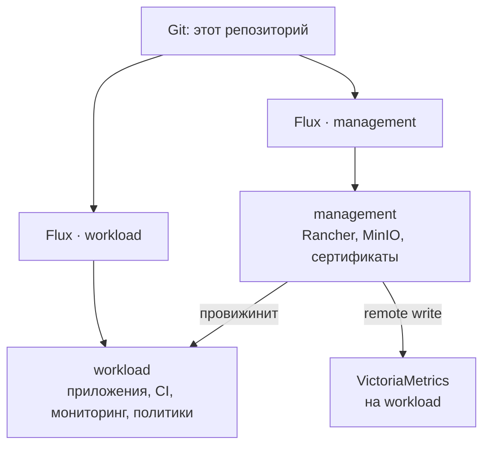

# Kubernetes GitOps platform

[](https://docs.rke2.io/)
[](https://fluxcd.io/)
[](https://www.rancher.com/)
[](https://kyverno.io/)

Anonymized portfolio copy of a production platform: two RKE2 clusters, Flux as the reconciler, Cilium instead of kube-proxy, VictoriaMetrics for metrics, logs and traces, Kyverno for policy. Names, addresses and credentials are replaced. The layout and the decisions are the ones that run the real system.

Два кластера Kubernetes. Что лежит в git — то и должно быть в кластере. Flux на каждом кластере раз в минуту забирает репозиторий и сам применяет diff. `kubectl` — для отладки, не для установки.

> Это обезличенная копия для портфолио. Её нельзя применять к кластеру как есть: домены и адреса примерные, содержимого OpenBao здесь нет. Значения, которые ещё лежат прямо в values чарта, заменены на `REDACTED`. Сгенерированные CRD Flux и черновики `*.yaml_bak` убраны.



## Два кластера

Папка в `k8s-manifests/` — один кластер. Flux читает только свою.

| Папка | Кластер | Зачем |
| --- | --- | --- |
| `k8s-manifests/management` | management | Rancher, MinIO, выпуск сертификатов. Отсюда описывается рабочий кластер. |
| `k8s-manifests/workload` | workload | Приложения, Redis, runners, мониторинг, Kyverno. |

Оба кластера — RKE2. Сеть — Cilium без kube-proxy: внешние IP анонсируются по L2, MetalLB нет. Диски приложений — NFS через CSI.

Ноды workload размечены ролью `environment=infra`, `runners` или `ingress`. Платформенные поды не садятся на раннеры, внешние адреса анонсируются только с ingress-нод. API VIP — отдельно, с control-plane.

Management свой Grafana не поднимает. vmagent снимает локальные метрики и пишет их на workload, с лейблом `cluster=management`.

## Как читать репозиторий

Манифесты разложены по типу объекта Kubernetes, а не по сервису. Искали Redis — `helmrelease/redis-*.yaml` и `ns/redis.yaml`. Искали алерт — `vmrule/`. Так ClusterIssuer и StorageClass не теряются между приложениями.

Исключение — `platform-security/` в корне. Kyverno и политики не размазаны по чартам: Flux на workload подключает этот каталог отдельными Kustomization.

Куда смотреть в первую очередь:

| Если интересно | Откройте |
| --- | --- |
| Что установлено | `k8s-manifests/workload/helmrelease/` |
| Как секреты попадают в кластер | `k8s-manifests/workload/externalsecret/` и `clustersecretstore/` |
| Сеть, DNS, ingress | `k8s-manifests/*/helmsconfig/` |
| Как management описывает рабочий кластер | `k8s-manifests/management/cluster/` |
| Политики | `platform-security/policies/` |
| Алерты и дашборды | `k8s-manifests/workload/vmrule/`, `cm/` |
| Свой экспортёр срока доменов | `k8s-manifests/workload/cm/domain-exporter-code.yaml` |
| Кто из CI видит кластер | `.gitlab/agents/` |

### GitOps и чарты

| Папка | Что это |
| --- | --- |
| `flux-system/` | Куда смотрит Flux: репозиторий, ветка `main`, своя папка кластера. Сами контроллеры ставит `flux bootstrap` и в git не лежат. |
| `helmrepository/` | Откуда брать чарты. Без записи здесь HelmRelease чарт не найдёт. |
| `helmrelease/` | Что поставить и с какими values. Основной каталог софта кластера. |

### Сеть, диски, ноды

| Папка | Что это |
| --- | --- |
| `helmsconfig/` | Настройка чартов, которые RKE2 ставит сам: Cilium, CoreDNS, ingress-nginx, Traefik. Это `HelmChartConfig`, не HelmRelease Flux. |
| `ippool/` | Пул внешних IP для LoadBalancer. Workload: `10.16.0.201–250`, анонс с `environment=ingress`. API VIP `10.16.0.205` анонсируется с control-plane. Management: `10.16.0.181–199`, API VIP `10.16.0.183`. |
| `ciliumclusterwidenetworkpolicy/` | Кластерные сетевые политики. Сейчас — L7 DNS visibility для Hubble, чтобы в Grafana был дашборд DNS. |
| `storageclass/` | Как создавать диски. По умолчанию `ha-nfs`: CSI на NFS `10.16.0.200:/data`. |
| `cluster/` | Только management. Объект Rancher `Cluster` для workload: `chartValues`, `machineGlobalConfig`, доступ к API. Пулы нод живут в Rancher. `prune` выключен специально: удаление файла не должно снести кластер. Смена `tls-san` или `disable` — rolling control-plane. |
| `clusterrepo/` | Каталоги чартов для UI Rancher, не для Flux. |

### Сертификаты и доступ

| Папка | Что это |
| --- | --- |
| `clusterissuers/` | Два ACME DNS-01: публичный DNS-провайдер и внутренний Technitium. |
| `certs/` | Wildcard-сертификаты `*.msk.corp.example` и `*.corp.example`, плюс отдельный сертификат Rancher. |
| `clustersecretstore/` | Откуда External Secrets читает значения. Здесь OpenBao и Kubernetes auth. |
| `externalsecret/` | Какой ключ в OpenBao становится каким Secret. В git путь и имя поля, не само значение. |
| `sa/` | ServiceAccount и RBAC. `gitlab-ci` на workload — executor для раннеров. `openbao-reviewer` нужен OpenBao только для TokenReview. |

### Изоляция

| Папка | Что это |
| --- | --- |
| `ns/` | Namespace создаются заранее, чтобы не ждать `createNamespace` у Helm. |
| `limitrange/` | Потолок ресурсов на под. Сейчас — Sentry. |
| `priorityclass/` | Кто выживает при нехватке памяти. `platform-critical` — webhook'и и всё, без чего кластер перестанет принимать поды. |
| `pvc/` | Диски вне Helm-релиза, например кэш GitLab runner. |

### Мониторинг

На workload крутится VictoriaMetrics Kubernetes Stack: метрики, логи, трейсы, Grafana, алерты. Снаружи стек закрыт vmauth: отдельные учётки на чтение UI и на запись с management.

| Папка | Что это |
| --- | --- |
| `vmpodscrape/` / `vmservicescrape/` / `vmstaticscrape/` / `vmprobe/` | Откуда снимать метрики, если сервис сам scrape не создаёт. |
| `vmrule/` | Алерты: ноды, поды, Cilium, Flux, cert-manager, Redis, GitLab, домены, балансировщики. Алерты Kyverno лежат в `platform-security/monitoring/`. |
| `vmalertmanagerconfig/` | Маршруты. Warning и выше уходят в командный чат, дайджест политик — раз в сутки. |
| `cm/` | Дашборды Grafana и конфиги, которые не вошли в чарт. |
| `ingress/` + `vmauth/` + `vmuser/` | Публичные имена VictoriaMetrics и кто имеет право туда ходить. |

## Политики

Kyverno стоит только на workload, на нодах `environment=infra`, с PriorityClass `platform-critical`. Admission смотрит рабочие namespace. `kube-system`, Flux и Rancher (`cattle-*`) не трогает ни webhook, ни фоновый скан.

Политики Pod Security — в **Audit**. Нарушение попадает в PolicyReport и в алерт, деплой не блокируется. `failureAction: Enforce` на них не включается, пока отчёт в UI не станет чистым: иначе HelmRelease начнут падать на создании подов. Исключение — `limit-review-namespaces`: она в Enforce и смотрит только объекты с лейблом `corp.example/review=true`.

Порядок Flux: сначала Kyverno и ожидание Ready, потом параллельно политики и Policy Reporter, потом scrape и алерты.

| Политика | Что проверяет |
| --- | --- |
| `pod-security-baseline` | Не privileged, без hostNetwork и hostPath без нужды. |
| `pod-security-restricted` | Поверх Baseline: non-root, drop ALL capabilities, seccomp `RuntimeDefault`. |
| `disallow-latest-tag` | У образа есть тег, и это не `:latest`. |
| `disallow-default-namespace` | Workload не в `default`. |
| `require-requests` | `cpu` и `memory` requests на каждом контейнере. |
| `require-probes` | `livenessProbe` и `readinessProbe` у Deployment, DaemonSet и StatefulSet. |
| `limit-review-namespaces` | Не больше двух review-namespace с приложением. Третий такой объект не создаётся. Enforce. |

Чарт без `securityContext` или DaemonSet с hostPath — это не повод выключить политику. Для них есть узкий `PolicyException`: namespace плюс имя или лейбл, не весь кластер. Почему исключение именно такое — комментарий в `00-exceptions-*.yaml`.

Admission-controller Down — critical. У webhook `failurePolicy=Fail`: если контроллер лёг, создание подов в рабочих namespace останавливается, даже пока политики в Audit.

## Что где крутится

**Оба кластера**

- cert-manager и webhook'и для публичного и внутреннего DNS
- External Secrets: Secret в кластере собирается из OpenBao, в git значения нет
- CSI NFS
- GitLab Agent
- VictoriaMetrics: на workload стек целиком, на management только vmagent

**Только management**

- Rancher
- MinIO
- Объект `Cluster` рабочего кластера

**Только workload**

- Sentry
- Redis Operator, репликация и HAProxy перед ней
- GitLab runners (`kube-runner` и `werf-runner`) на нодах `environment=runners`
- cluster-autoscaler через API Rancher
- VPA: CPU и memory поднимаются на живом поде, `updateMode: InPlaceOrRecreate`
- дашборды Rancher Monitoring для Cluster Explorer
- Kyverno и Policy Reporter
- descheduler и overprovisioning, чтобы на нодах оставался запас под всплеск

Новый сервис обычно состоит из namespace в `ns/`, HelmRepository, если чарта ещё нет, и HelmRelease. Сертификат — в `certs/`. Секрет — `ExternalSecret` на тот же OpenBao: путь `workload/<namespace>/<имя>` или `management/<namespace>/<имя>`. Kyverno сразу начинает Audit: нет requests, проб или non-root — в отчёте будет fail. Дальше либо правится чарт, либо добавляется узкое исключение.

## Как меняется кластер

1. Правка в папке нужного кластера. Политики — в `platform-security/`, не в `helmrelease/`.
2. Push в `main`.
3. Flux подхватывает коммит. `prune: true` удаляет из кластера объект, удалённый из git. Объект `Cluster` на management — исключение, у него prune выключен.

```bash
flux get kustomizations -A
flux get helmreleases -A
flux reconcile source git flux-system
```

Values в git важнее того, что когда-то поставили руками. `flux-system/gotk-*` руками не правят. На объект `Cluster` не ставят `force`: Flux пересоздаст его почти пустым и снесёт пулы машин.

## Чего в этой копии нет

- содержимого OpenBao: в git только пути и имена ключей
- значений, которые ещё прописаны в values чарта: в этой копии они `REDACTED`
- приватного материала сертификатов
- настоящих имён, доменов, адресов и идентификаторов чатов
- `gotk-components.yaml` — это сгенерированные CRD и контроллеры Flux, десятки тысяч строк апстрима
- черновиков `*.yaml_bak`
